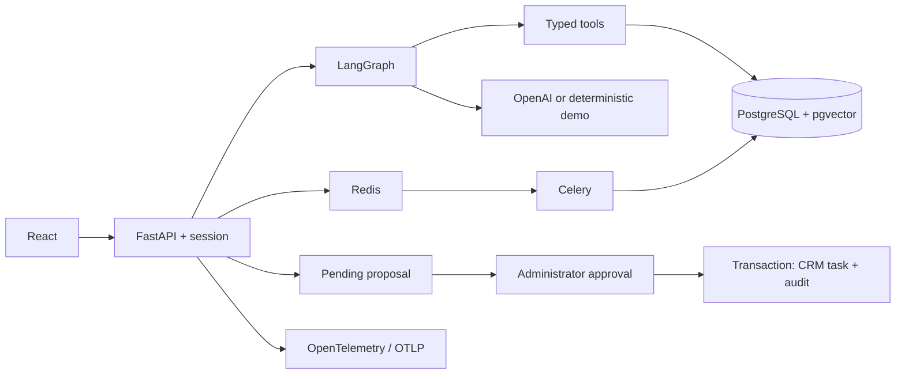

# Architecture and trade-offs

## Modular monolith

The API and worker share domain services, schemas, and transactions. HTTP, agent, domain, and
retrieval concerns are separated without introducing distributed service coordination prematurely.
SQLAlchemy is synchronous; blocking HTTP handlers use `def` so FastAPI runs them in its thread pool.

## Authentication and isolation

The tenant comes from the authenticated session, never model-supplied arguments. Queries and
retrieval filter by tenant, with RLS as defense in depth for non-superuser runtime connections.
`session_scope(tenant_id)` sets tenant context only for that transaction. PostgreSQL superusers
bypass RLS: use scripts/provision_runtime.py, a restricted DATABASE_URL, and a separate migration DSN.
The configured local runtime role has neither SUPERUSER nor BYPASSRLS privileges.

Session tokens are random and opaque. Only their hashes are stored; sessions expire and logout
revokes them. Cookies are HttpOnly and SameSite=Strict; cookie-authenticated mutations validate
Origin. API/MCP clients can use bearer tokens. HTTPS and COOKIE_SECURE=true are required outside
localhost. Passwords use salted PBKDF2-HMAC-SHA256 with 600,000 iterations.

Redis limits login, chat, search, and ingestion requests. Operations requiring the limiter fail
closed if it is unavailable. The UI clears the previous workspace before loading another session
and discards stale refresh responses.

## Human approval and idempotency

The model can read or propose; it has no approval tool. The administrator-only decision endpoint
locks the proposal with SELECT FOR UPDATE and creates the CRM task, audit event, and final action
state in one transaction. Repeating the same approval returns the existing result. A unique
constraint on action_id prevents duplicate tasks. Proposal idempotency uses a tenant-specific key
and transaction-level advisory lock.

The CRM is local. An external CRM adapter should use a transactional outbox and destination-side
idempotency before claiming reliable delivery across network failures.

## Agent and retrieval

The graph limits rounds and tool calls, validates arguments with extra=forbid, and exposes no raw
SQL, shell, arbitrary HTTP, or approval capability. Retrieved text is untrusted data. Prompting is
not treated as an authorization boundary: the code and database enforce access.

Runs persist questions, answers, tool results, retrieved sources, generation tokens, and latency.
This is an operational record, not storage of hidden model reasoning. The English system prompt
also instructs the model to cite sources and distinguish proposals from completed actions.

Documents are split into 1,200-character chunks with 200-character overlap. Exact cosine-distance
retrieval filters by tenant and embedding model. For this small dataset, exact search avoids ANN
recall/filtering complexity. Introduce HNSW only after benchmarking the actual workload.
The similarity threshold is heuristic and needs calibration on representative examples.

Demo retrieval uses deterministic lexical vectors. Real mode requests 384-dimensional embeddings.
Changing model or document language requires reindexing. Celery uses bounded retries and acks_late;
chunk replacement is atomic under a document row lock. Failed queue publication leaves a persisted
document recoverable via reindexing. A transactional dispatcher/outbox would strengthen delivery.

## Observability and evaluation

Request logs include IDs, routes, status, and duration, not request bodies or credentials.
HTTP, tools, agent runs, and retrieval have OpenTelemetry instrumentation; OTLP export is optional.
Business metrics are tenant-scoped; process Prometheus counters require an administrator.
Generation cost estimates exclude embeddings and infrastructure and do not enforce spending caps.

Synthetic demo evaluations cover tool use, simple facts, citations, and approval behavior.
Real LLM evaluation requires account credentials, a broader dataset, and explicit measures of
retrieval quality, groundedness, failures, tool success, latency, and cost.

## Current boundaries

- AWS configuration is prepared; no cloud resources or paid deployment have been created.
- The CRM is fictional, without Salesforce/HubSpot OAuth or synchronization.
- Ingestion accepts text, not PDFs.
- Chat requests are independent; persisted history is not conversational memory.
- Responses return as complete HTTP payloads, without token streaming.
- Approval uses persisted domain state, not a LangGraph interrupt/checkpointer.
- Billing, SSO, account recovery, automated backups, and organization management UI are not implemented.
- Before production: validate TLS, secrets management, SSO, retention, backup restoration,
  penetration testing, tenant budgets, global concurrency limits, and external integration behavior.
